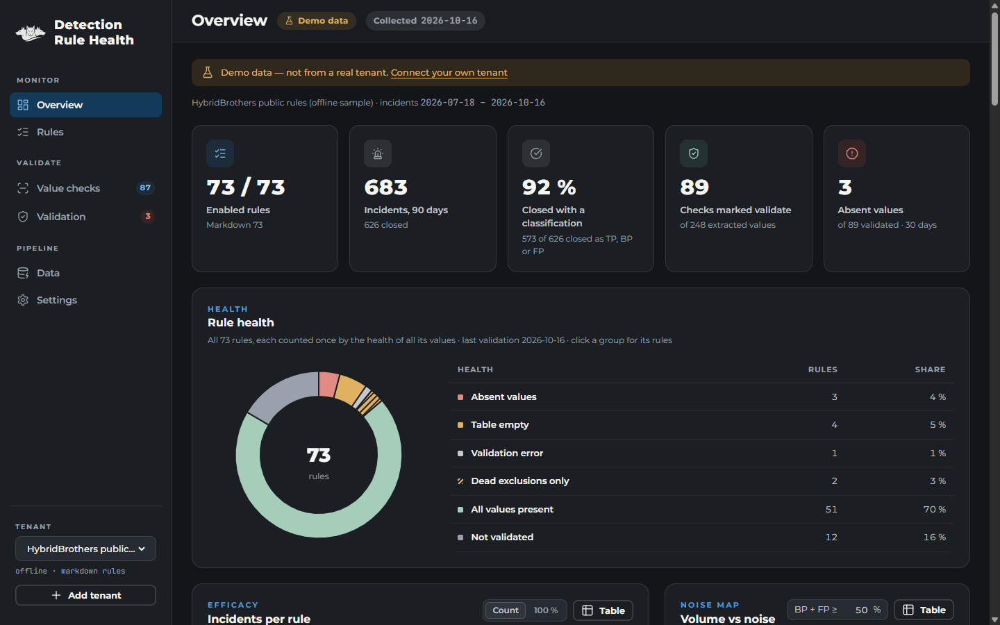

<p align="center">
  
</p>

<h1 align="center">Detection Rule Health</h1>

<p align="center">
  One local overview of your <b>Microsoft Sentinel analytics rules</b> and <b>Defender XDR custom detections</b>:<br>
  how well each rule performs, and whether the values it depends on still exist in your data.
</p>

<p align="center">
  <a href="https://github.com/Cerberus-Cyber-Consulting/DetectionRuleHealth/actions/workflows/ci.yml"></a>
  &nbsp;<b>Public beta</b>&nbsp;·&nbsp;MIT license&nbsp;·&nbsp;runs on your machine
</p>

<p align="center">
  <a href="https://detectionhealth.cerberuscyberconsulting.com/">Documentation</a> ·
  <a href="https://detectionhealth.cerberuscyberconsulting.com/quick-start/">Quick start</a> ·
  <a href="https://detectionhealth.cerberuscyberconsulting.com/setup/">Setup guide</a> ·
  <a href="PRIVACY.md">Privacy</a> ·
  <a href="https://github.com/Cerberus-Cyber-Consulting/DetectionRuleHealth/releases">Releases</a>
</p>



## Why

Rules drift. A Sentinel analytics rule or a Defender XDR custom detection can keep running for
months while it can never fire again: a connector changed, an `ActionType` was renamed, a column
moved. And the portals do not show you, per rule, how many incidents it produced and how they were
classified.

Detection Rule Health answers two questions per rule:

1. **Is it worth its noise?** Incidents created, and the true positive / benign positive / false
   positive / undetermined / open split, with counts next to every rate.
2. **Can it still fire?** Every literal value a rule compares against (`ActionType == "LogonFailed"`,
   `OperationName in (...)`) is extracted with Microsoft's own KQL parser. You pick which values must
   always occur in normal telemetry (and skip the ones that only show up during an attack); the app
   checks that they still do.

## Quick start

You need a container runtime (Docker Desktop, Docker Engine, Podman or Rancher Desktop) and an
administrator who can consent to the read permissions. To use your own app registration (recommended)
you also need to be able to create one, or someone who can.

**1. Start the container**

```sh
docker run -d --name detectionrulehealth \
  -p 127.0.0.1:5180:5180 -v drh-data:/data \
  --read-only --tmpfs /tmp --cap-drop ALL --security-opt no-new-privileges \
  --restart unless-stopped \
  ghcr.io/cerberus-cyber-consulting/detectionrulehealth:beta
```

Or with Compose: download [`compose.yaml`](compose.yaml) and run `docker compose up -d`.

**2. Choose how to sign in**

- **Your own app registration (recommended).** One single-tenant app registration in your own tenant,
  platform *Mobile and desktop applications*, redirect URI `http://localhost:5180/auth/callback`, no
  secret. Run [`tools/New-DrhAppRegistration.ps1`](tools/New-DrhAppRegistration.ps1) (Azure CLI) or
  follow the [portal steps](https://detectionhealth.cerberuscyberconsulting.com/setup/#create-the-app-registration),
  then grant admin consent. Consent covers this tool only.
- **Microsoft's apps (quick start).** No app registration: the app signs in as Microsoft Graph Command
  Line Tools and Microsoft Azure PowerShell. An administrator still consents to the security
  permissions, and that consent then also applies to everyone's Graph PowerShell in the tenant.
  [Compare the options](https://detectionhealth.cerberuscyberconsulting.com/setup/#choose-how-to-sign-in).

**3. Open <http://localhost:5180>**

The setup wizard asks how to sign in and for the tenant id (and your client id), signs you in with
Microsoft, lets you pick your Sentinel workspaces and runs the first collection. No connected tenant
yet? Choose *Explore with demo data*.

## Permissions

Delegated permissions, on your own app registration or consented for Microsoft's apps. The app can never do more than the signed-in user
is allowed to do, and it only reads.

| API | Permission | Used for |
|---|---|---|
| Microsoft Graph | `CustomDetection.Read.All` | Defender XDR custom detection rules |
| Microsoft Graph | `ThreatHunting.Read.All` | advanced hunting queries and schema |
| Microsoft Graph | `SecurityIncident.Read.All` | incidents |
| Microsoft Graph | `SecurityAlert.Read.All` | linking alerts to custom detection rules |
| Azure Service Management | `user_impersonation` | Sentinel analytics rules, workspaces, tables |
| Log Analytics API | `Data.Read` | queries in your workspace |

The signed-in user also needs **Security Reader** (or an equivalent Defender XDR role with advanced
hunting) and **Microsoft Sentinel Reader** on the workspace.

## Privacy in one paragraph

Detection Rule Health has no backend. It runs in a container on your computer, signs in with your
own app registration or Microsoft's public apps, and writes its results only to your Docker volume. Tokens are kept in memory
and never saved. There is no telemetry. The only call that does not go to Microsoft is a daily check
of this repository's GitHub Releases for a newer version, which you can turn off with
`-e RULEHEALTH_UPDATE_CHECK=false`. Details: [PRIVACY.md](PRIVACY.md).

## Upgrade, verify, remove

```sh
# upgrade (your data stays in the drh-data volume)
docker pull ghcr.io/cerberus-cyber-consulting/detectionrulehealth:beta
docker rm -f detectionrulehealth      # then run the same docker run command again

# verify the image was built by this repository's release workflow
gh attestation verify oci://ghcr.io/cerberus-cyber-consulting/detectionrulehealth:beta \
  -R Cerberus-Cyber-Consulting/DetectionRuleHealth

# remove everything
docker rm -f detectionrulehealth && docker volume rm drh-data
```

The app shows a notice when a newer release is available. It never updates itself.

## Good to know

- **Beta.** Expect rough edges. Data formats may still change between beta versions.
- **Port 5180 is fixed** because the sign-in redirect URI points to it. Keep `127.0.0.1:` in the
  port mapping so only your own computer can reach the app.
- **Docker Desktop licensing:** Docker Desktop is free for personal use and small businesses, but
  larger organisations need a paid subscription. Podman Desktop, Rancher Desktop and Docker Engine
  (also inside WSL2) work without one. See the [setup guide](https://detectionhealth.cerberuscyberconsulting.com/setup/#container-runtime).
- Classification rates are only as good as how consistently your SOC classifies incidents.
- Advanced hunting looks back at most 30 days, so value checks cover 30 days at most.

## Building from source

```sh
dotnet test                                   # .NET 10 SDK
dotnet run --project src/RuleHealth.Cli -- serve --data samples
docker build --build-arg VERSION=0.0.0-dev -t detectionrulehealth:dev .
```

Contributions are welcome: open an issue first for anything larger than a fix. Never include tenant
data in issues, tests or screenshots.

## License

[MIT](LICENSE) © 2026 Cerberus Cyber Consulting BV. Provided as is, without warranty of any kind.
Third-party components and their licenses: [THIRD-PARTY-NOTICES.md](THIRD-PARTY-NOTICES.md).

## Trademarks

The Cerberus Cyber Consulting name, logo and hound mark belong to Cerberus Cyber Consulting BV and
are not licensed under MIT; forks must not use them to suggest they are the original project.
Microsoft, Microsoft Sentinel, Microsoft Defender XDR, Microsoft Entra and Azure are trademarks of
the Microsoft group of companies. Detection Rule Health is not affiliated with or endorsed by Microsoft.

---

Made in Belgium by [Cerberus Cyber Consulting](https://cerberuscyberconsulting.com).
